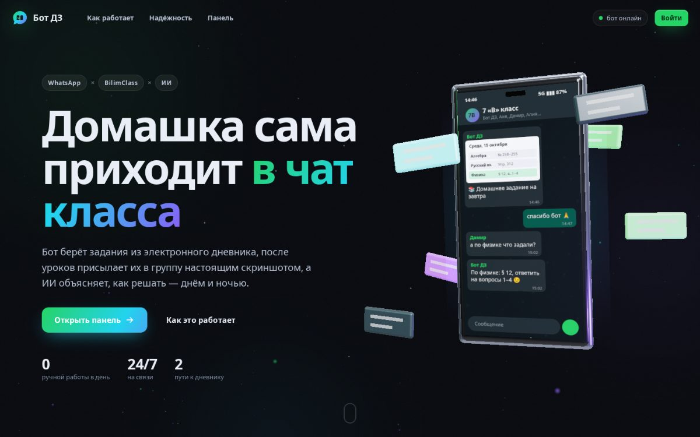
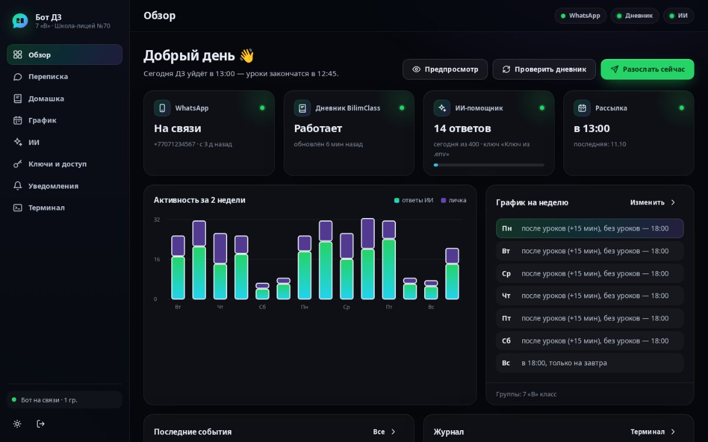
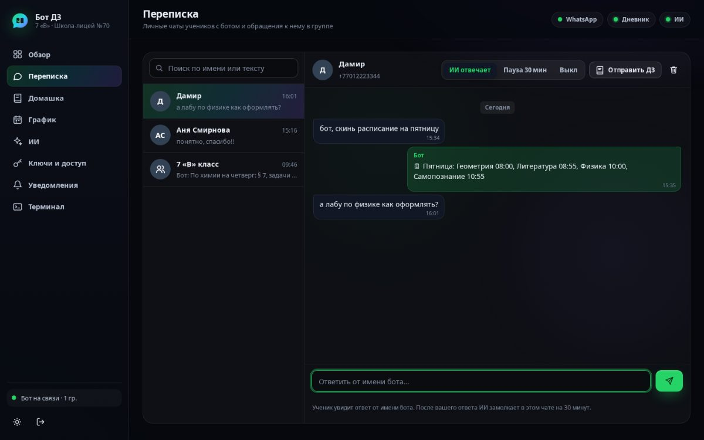
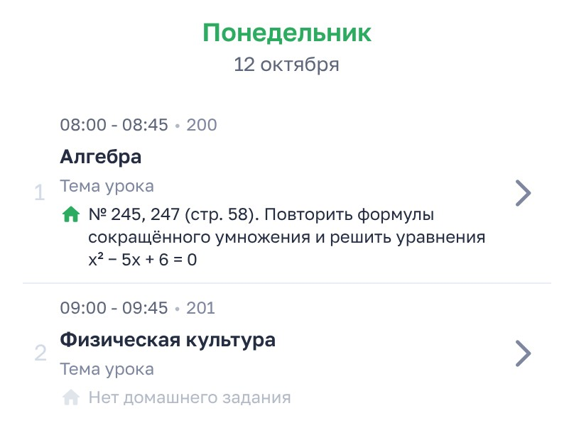
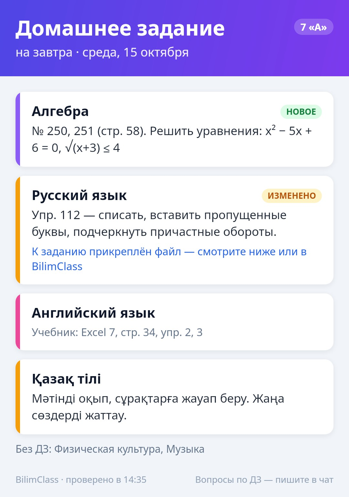

# 📚 WhatsApp-бот домашних заданий (BilimClass + ИИ Groq)

Бот сидит в WhatsApp-группе класса и работает 24/7. У него есть сайт с 3D-презентацией и панель управления.

- **После уроков присылает скриншот дневника.** Бот смотрит в расписании **BilimClass** (bilimclass.kz), когда закончился последний урок, через 15 минут открывает дневник и присылает **скриншот дня** с подписью **«📚 Домашнее задание на завтра»**. Если на другие дни выставили новое ДЗ, приходит и их фото («🆕 Новое домашнее задание на четверг»). Уже отправленное бот не повторяет.
- **Вы решаете, когда присылать.** Для каждого дня недели своё: «после уроков», «в своё время» или «не присылать». В воскресенье по умолчанию — только ДЗ на понедельник, без заданий на всю неделю. Есть пауза (каникулы) и пропуск отдельных дней — в панели или командами `!график`, `!пауза`, `!пропустить`.
- **Только свежие данные.** Рассылка и проверки каждый раз скачивают дневник заново. Старые данные бот не подсовывает.
- **Не отваливается.** Два пути к дневнику: если API BilimClass сбоит, бот берёт дневник через сайт в браузере. Вход продлевается сам (как в приложении). Очередь сообщений переживает перезагрузку. Сторож следит за WhatsApp, памятью и зависаниями. Технические уведомления получают только админы — в личку, не в группу.
- **ИИ-помощник (Groq) отвечает по-человечески.** Понимает вопросы по учёбе, фото задания и голосовые, видит, что задано в дневнике, и не выдумывает задания. Печатает, пишет короткими сообщениями, помнит разговор в личке — и честно говорит, что он бот.
- **Личка.** Ученик может написать боту «скинь дз на завтра», «что по алгебре?», «расписание на пятницу» — без всяких `!` — и получит фото из дневника или ответ.
- **Панель управления** в браузере: обзор, переписка учеников с ботом (можно ответить самому), домашка недели с предпросмотром фото, график, настройки ИИ, ключи и доступ (ключи ИИ, запасной ИИ, вход в дневник, привязка WhatsApp по QR), журнал уведомлений и терминал с командами бота.



| Панель: обзор | Панель: переписка |
|---|---|
|  |  |

| Скриншот дневника (по умолчанию) | Карточка (запасной вариант) |
|---|---|
|  |  |

---

## ⚠️ Важно знать заранее

1. **Нужен отдельный номер WhatsApp для бота** (вторая SIM-карта, eSIM или WhatsApp Business на втором номере). Бот подключается как «связанное устройство» через неофициальную библиотеку [Baileys](https://github.com/WhiskeySockets/Baileys). WhatsApp может заблокировать номер за спам, поэтому не используйте основной номер и не рассылайте сообщения посторонним.
2. **У BilimClass нет официального API.** Бот работает так же, как сайт дневника, через логин и пароль ученика. Если BilimClass изменит сайт, бот сначала попробует запасной путь, а если и он не сработает — напишет админу.
3. Логин, пароль и ключи хранятся только на вашем сервере (`.env` и `data/secrets.json` с доступом только для владельца). Не публикуйте их.
4. Переписку учеников с ботом видит админ в панели. Бот честно предупреждает об этом в первом сообщении в личке.

---

## Что понадобится

| Что | Где взять |
|---|---|
| Сервер (VPS) с Linux, 1–2 ГБ RAM | любой хостинг (Ubuntu 22.04/24.04). Подойдёт и домашний компьютер, если он не выключается |
| Номер WhatsApp для бота | вторая SIM / eSIM, WhatsApp на любом телефоне |
| Логин и пароль BilimClass | ученика, чей дневник показывать |
| Ключ Groq (бесплатно) | https://console.groq.com/keys → *Create API Key* (можно добавить и потом, в панели) |

---

## Установка

### 1. Скачать бота на сервер

```bash
git clone https://github.com/a1x10/project3.git
cd project3/whatsapp-homework-bot
```

> Если бот ещё не слит в ветку `main`, клонируйте его ветку: `git clone -b claude/lucid-mendel-7ktxm0 https://github.com/a1x10/project3.git`

### 2. Заполнить настройки

```bash
cp .env.example .env
nano .env
chmod 600 .env
```

Минимум:

```ini
BILIM_LOGIN=логин_ученика
BILIM_PASSWORD=пароль
GROQ_API_KEY=gsk_...
ADMIN_NUMBERS=77011234567          # ваш номер: уведомления, админ-команды, вход в панель по коду
WA_PAIRING_NUMBER=77001234567      # номер БОТА (для привязки кодом). Можно оставить пустым и привязать по QR
ADMIN_PANEL_PASSWORD=длинный-пароль-для-панели
```

Остальное описано в `.env.example`. Почти всё (график, ИИ, ключи, вход в дневник) потом удобнее менять в панели — без перезапуска.

### 3. Запустить. Вариант А: Docker (рекомендуется)

```bash
# если Docker ещё не установлен:
curl -fsSL https://get.docker.com | sh

docker compose build
docker compose run --rm bot npm run check   # проверка: вход в BilimClass, ДЗ, скриншот дневника, ключ Groq
docker compose up -d
docker compose logs -f        # здесь появится QR-код или код привязки
```

Бот сам перезапускается после сбоев и перезагрузки сервера (`restart: unless-stopped`). Данные (сессия WhatsApp, состояние, настройки из панели) хранятся в Docker-томе `bot-data`.

### 3. Запустить. Вариант Б: Node.js + PM2

```bash
# Node.js 22 (если не установлен)
curl -fsSL https://deb.nodesource.com/setup_22.x | sudo -E bash -
sudo apt-get install -y nodejs

npm ci --omit=dev
sudo npx playwright-core install-deps chromium   # системные библиотеки для браузера (один раз)
npx playwright-core install chromium             # браузер для скриншотов и запасного пути к дневнику
npm run check
npm start                     # первый запуск вручную, чтобы привязать WhatsApp (Ctrl+C после привязки)

sudo npm i -g pm2
pm2 start ecosystem.config.cjs
pm2 save && pm2 startup       # автозапуск после перезагрузки сервера
pm2 logs homework-bot
```

Можно и через systemd: файл `deploy/homework-bot.service`, инструкция внутри.

### 4. Привязать WhatsApp

На телефоне с номером бота: **WhatsApp → Настройки → Связанные устройства → Привязка устройства**.

- **По коду** (если задан `WA_PAIRING_NUMBER`): в логах появится `КОД ДЛЯ ПРИВЯЗКИ WHATSAPP: ABCD-EFGH`. Нажмите «Привязать по номеру телефона» и введите код.
- **По QR**: отсканируйте QR из логов — или откройте панель (раздел «Ключи и доступ» → WhatsApp), там QR показывается крупно и обновляется сам.

Привязка нужна один раз: сессия сохраняется в `data/wa-auth`.

### 5. Подключить группу класса

1. Добавьте номер бота в WhatsApp-группу класса.
2. В группе напишите **`!привязать`** (админ группы или номер из `ADMIN_NUMBERS`).
3. Бот ответит, что группа подключена. Проверьте командой `!дз`.

Первая рассылка — только «ДЗ на завтра»: всё, что уже есть в дневнике, бот запоминает, а не вываливает разом.

---

## Панель управления и сайт

Сайт с 3D-презентацией бота — `http://адрес:порт/`, панель — `/app`.

**Как открыть.** По умолчанию порт открыт только на самом сервере (это безопасно). С вашего компьютера:

```bash
ssh -L 3000:127.0.0.1:3000 user@IP-сервера     # окно не закрывайте
```

и откройте в браузере **http://localhost:3000**. (Если в `.env` задан `BOT_HTTP_PORT`, подставьте его вместо второго `3000`.)

Постоянный адрес с HTTPS (по желанию): нужен домен и обратный прокси на сервере, например Caddy:

```text
bot.example.kz {
    reverse_proxy 127.0.0.1:3000
}
```

и в `.env`: `PANEL_PUBLIC_URL=https://bot.example.kz`, `TRUST_PROXY=true`. Без HTTPS панель наружу не открывайте.

**Вход:** пароль (`ADMIN_PANEL_PASSWORD` или заданный в панели) или **код из WhatsApp**, который бот присылает админам. Забыли пароль — напишите боту в личку `!панель`: придёт одноразовая ссылка для входа (только админам).

**Разделы:**

| Раздел | Что там |
|---|---|
| Обзор | WhatsApp, дневник, ИИ, во сколько сегодня рассылка; график активности; события; живой журнал. Кнопки «Предпросмотр», «Проверить дневник», «Разослать сейчас» |
| Переписка | личные чаты учеников с ботом и обращения к нему в группе. Можно ответить от имени бота — ИИ в этом чате подождёт 30 минут. ИИ можно выключить для отдельного чата. Кнопка «Отправить ДЗ» |
| Домашка | неделя из дневника, предпросмотр фото «как увидит класс», ДЗ вручную |
| График | для каждого дня недели: после уроков / в своё время / не присылать; «завтра + новое» или «только на завтра»; пауза, пропуск дней, параметры, группы |
| ИИ | когда отвечает, стиль, «как человек», голос и фото, лимиты, проверка вопросом |
| Ключи и доступ | ключи Groq (добавить, проверить, сделать основным, удалить), запасной ИИ, вход в BilimClass («проверить и сохранить», «войти заново»), WhatsApp («переподключить», «привязать заново» с QR), пароль панели и сессии, перезапуск |
| Уведомления | журнал проблем и восстановлений, уведомления админам, вечерний отчёт, кто может писать в личку |
| Терминал | команды бота прямо в браузере: `status`, `logs -f` (живой журнал), `dz завтра`, `digest preview`, `check`, `wa reconnect`, `ai ask …` и др. (`help`). Это не shell сервера |

**Безопасность панели:** пароль хранится как scrypt-хеш; сессия — в HttpOnly-куке `SameSite=Strict`; изменения принимаются только со своей страницы (защита от CSRF); перебор паролей и кодов ограничен; строгая политика CSP; ключи и пароли наружу отдаются только маской; на диске — с правами 600.

**Демо-режим** — сайт и панель на примерных данных, без WhatsApp и дневника (удобно показать проект): `npm run demo` → http://localhost:3100, пароль `demo-panel`.

---

## Команды в WhatsApp

| Команда | Что делает |
|---|---|
| `!дз` | фото с ДЗ на ближайший учебный день (до 12:00 в учебный день — на сегодня) |
| `!дз завтра` · `!дз пт` · `!дз 20.10` | ДЗ на конкретный день |
| `!дз алгебра` | ближайшее ДЗ по предмету (понимает «матем», «англ», «физра» и т.п.) |
| `!неделя` · `!неделя след` | ДЗ на всю неделю |
| `!расписание [день]` | уроки, время, кабинеты |
| `!файлы [день]` | прислать файлы к заданиям |
| `!спросить вопрос` | спросить ИИ напрямую |
| `!помощь` | список команд |

В личке то же самое можно просить обычными словами: «скинь дз на завтра», «что задали по физике?», «какие уроки в пятницу». В группе — обращаясь к боту: «бот, скинь дз на завтра».

**Для админов:**

| Команда | Что делает |
|---|---|
| `!привязать` / `!отвязать` | присылать или не присылать ДЗ в эту группу |
| `!график` | когда бот присылает ДЗ по дням |
| `!график вс выкл` · `!график пт 15:00` · `!график будни после уроков` · `!график вс только завтра` | изменить график |
| `!пауза` · `!пауза 3` · `!пауза до 20.10` · `!продолжить` | остановить и вернуть рассылки |
| `!пропустить` · `!пропустить завтра` · `!пропустить 20.10` | без рассылки в этот день (повторно — отменить) |
| `!рассылка` | проверить дневник и прислать новые ДЗ прямо сейчас |
| `!обновить` | проверить дневник на изменения сейчас |
| `!автоответ вкл/выкл` | ИИ сам отвечает на вопросы в группе |
| `!авторассылка вкл/выкл` | ежедневная рассылка в эту группу |
| `!добавить завтра Алгебра: №250-255` · `!удалить N` | ДЗ вручную |
| `!статус` · `!группы` · `!id` | состояние бота, список групп, ID чата |
| `!панель` | одноразовая ссылка для входа в панель (только в личке) |

Админы бота: номера из `ADMIN_NUMBERS`, админы WhatsApp-группы класса и сам владелец номера бота (команды, набранные с его телефона).

---

## Как работает ИИ-помощник

ИИ видит ДЗ из дневника за последние 3 дня и на неделю вперёд, расписание ближайших дней и последние сообщения. В личке он помнит переписку за сутки (даже после перезапуска бота).

**Когда отвечает** (режим «умный»): когда его позвали (`@упоминание`, ответ на его сообщение, «бот, …», `!спросить`, личка) и когда сообщение похоже на вопрос по учёбе — сначала быстрая проверка по словам, потом лёгкая модель решает, отвечать ли. На болтовню и вопросы конкретному человеку бот не отвечает.

**Как человек** (`AI_HUMAN_LIKE=true`, по умолчанию): отмечает сообщение прочитанным, через секунду «печатает…» (столько, сколько печатал бы человек), длинный ответ присылает двумя-тремя сообщениями, пишет без шаблонных фраз. На прямой вопрос «ты бот?» отвечает честно.

**Фото и голос:** фото задания с вопросом или ответ боту на фото; голосовые расшифровываются Whisper.

**Ключи.** В панели можно хранить несколько ключей **одного вашего аккаунта** Groq: если ключ отзовут или он утечёт, бот сам перейдёт на следующий и напишет админу. Лимиты Groq общие на аккаунт, поэтому ключи разных аккаунтов ради обхода лимитов добавлять нельзя — это запрещено правилами Groq; бот меняет ключ только когда текущий не работает, а не из-за лимита. Если Groq недоступен или перегружен, может отвечать **запасной ИИ** — любой OpenAI-совместимый сервис (OpenRouter, Together, свой сервер).

**Модели Groq** (октябрь 2026): `openai/gpt-oss-120b` (основная), `openai/gpt-oss-20b` (фильтр вопросов), `qwen/qwen3.8-27b` (фото), `whisper-large-v3-turbo` (голос). Если Groq отключит модель, бот перейдёт на запасную (`GROQ_FALLBACK_MODELS`).

**Лимиты:** не больше `AI_USER_LIMIT` вопросов от одного человека за `AI_USER_WINDOW_MINUTES` минут и `AI_DAILY_LIMIT` ответов в сутки.

---

## Надёжность: что бот делает сам

| Что случилось | Что делает бот |
|---|---|
| Истёк вход в BilimClass (HTTP 426/401) | продлевает вход, как сайт, а если не вышло — входит заново по паролю |
| API BilimClass сломалось или изменилось | 30 минут берёт дневник через сайт в браузере, потом снова пробует API. Админу — одно сообщение |
| BilimClass недоступен совсем | не присылает старые данные, повторяет попытки; админу — сообщение после 3 сбоев и «✅ восстановлено», когда заработает |
| Обрыв связи с WhatsApp | переподключается; если долго не выходит — сторож переподключает принудительно; сообщения ждут в очереди на диске |
| Бот был выключен в момент рассылки | отправит её после запуска (до конца `ACTIVE_HOURS`) |
| Ключ Groq отозван | переходит на запасной ключ; Groq лежит — на запасной ИИ |
| Скриншот не получился | присылает нарисованную карточку с теми же заданиями |
| Процесс разросся по памяти или завис | сторож снимает блокировку или аккуратно перезапускает бота |

Все технические сообщения уходят только админам в личку (`ADMIN_NUMBERS`) и в журнал панели — в группу класса никогда.

---

## Если что-то не так

| Проблема | Решение |
|---|---|
| `Неправильный логин или пароль` | смените логин/пароль в панели («Ключи и доступ» → «Проверить и сохранить») или в `.env`. После ошибки бот ждёт 30 минут перед новой попыткой, чтобы аккаунт не заблокировали |
| ДЗ показывается не на тот день | `npm run check` покажет, на какой день попадают задания. Если они стоят на дне, когда их задали, поставьте `HOMEWORK_ATTACHED_TO=assigned` |
| Бот не отвечает в группе | группа не привязана: напишите `!привязать`. Проверьте `!статус` |
| ИИ молчит | в панели «Ключи и доступ» проверьте ключ Groq; режим ИИ и `!автоответ` |
| Не нужно присылать ДЗ в воскресенье / в какой-то день | панель → «График» или `!график вс выкл` |
| `сессия открыта в другом месте` | запущены две копии бота с одной сессией. Оставьте одну |
| Бот отвязался от телефона | панель → «Ключи и доступ» → WhatsApp → QR-код (или код в логах) |
| Вместо скриншота пришла карточка | сайт BilimClass не открылся или изменился. Причина в журнале; `npm run check` сохранит пробный скриншот в `data/screenshot-check.jpg` |
| `Chromium не найден` | без Docker: `npx playwright-core install chromium` (и `sudo npx playwright-core install-deps chromium`) или `CHROMIUM_PATH` |
| Рассылка слишком рано | увеличьте «через сколько минут после уроков» в панели (`DIGEST_DELAY_MINUTES`) |
| Не открывается панель | порт открыт только на сервере — используйте SSH-туннель (см. выше). Проверьте, что в `.env` задан `ADMIN_PANEL_PASSWORD` или `ADMIN_NUMBERS` |

**Мониторинг:** `curl http://127.0.0.1:3000/health` → `200` (`ok`) или `503` (WhatsApp не на связи больше 10 минут). Подходит для UptimeRobot.

**Обновление бота:**

```bash
cd ~/project3/whatsapp-homework-bot
git pull
docker compose up -d --build      # или: npm ci --omit=dev && pm2 restart homework-bot
```

**Резервная копия:** папка `data/` (или Docker-том `bot-data`): сессия WhatsApp, состояние, настройки и секреты из панели, переписка.

---

## Для разработчиков

```text
src/
  index.js                точка входа, сборка компонентов, корректная остановка
  config.js               чтение и проверка .env, план рассылки по дням
  settings.js             настройки на ходу (data/settings.json поверх .env)
  secrets.js              секреты из панели (data/secrets.json, права 600)
  core.js                 группы, админы, уведомления, вечерний отчёт
  scheduler.js            рассылка по графику дня, только новые ДЗ, проверки днём, догонялка
  watchdog.js             сторож: WhatsApp, зависания, память
  inbox.js                переписка для панели
  bilimclass/client.js    API BilimClass: вход, продление (426), повторный вход, повторы
  bilimclass/resilient.js два пути к дневнику: API → сайт в браузере
  bilimclass/screenshot.js  сайт BilimClass в Chromium: скриншоты и запасное чтение дневника
  homework/*              дневник → ДЗ по дням, текст, карточки, фото
  ai/groq.js · ai/keys.js · ai/assistant.js · ai/prompts.js   ИИ: ключи, запасной ИИ, ответы
  whatsapp/*              Baileys, входящие сообщения, команды, просьбы обычными словами
  web/server.js · web/auth.js · web/console.js   сайт, API панели, вход, терминал
web/                      сайт (Three.js) и панель (без сборки, ES-модули)
scripts/check.js          проверка настроек; scripts/demo.js — демо-режим
tests/                    тесты (node --test) без сети + тесты на настоящем сайте BilimClass
```

```bash
npm install
npm test            # быстрые тесты без сети
npm run test:site   # сайт BilimClass в браузере с подменёнными данными (нужны интернет и Chromium)
npm run demo        # сайт и панель на примерных данных
```

Эндпоинты BilimClass: `POST /api/v2/os/login`, `POST /api/v2/os/refresh_token`, `GET /api/v4/os/clientoffice/diary?schoolId&eduYear&date=ДД.ММ.ГГГГ(пн)&groupId`, `GET /api/v4/os/clientoffice/homeworks/simple-homework/info?homeworkUuid`. Нужны заголовки `X-Localization`, `X-Mathrix`, `Origin`. Ответ `426` означает «токен устарел — продлите вход».
